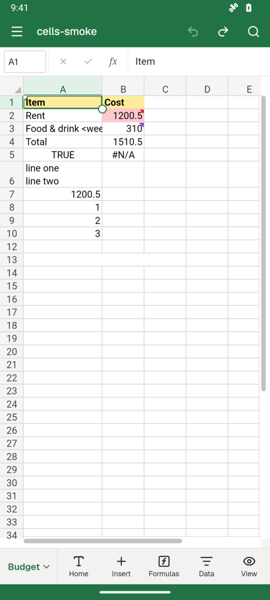
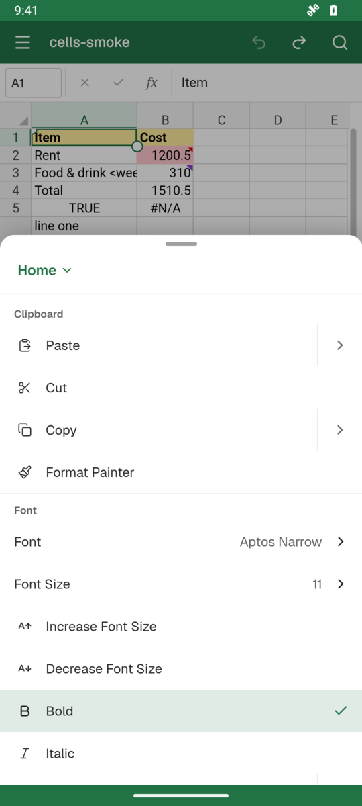
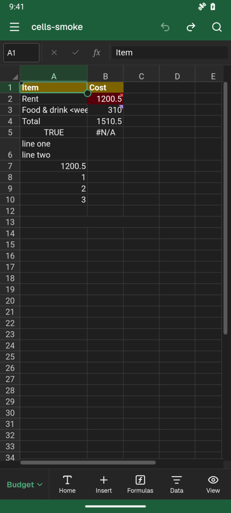
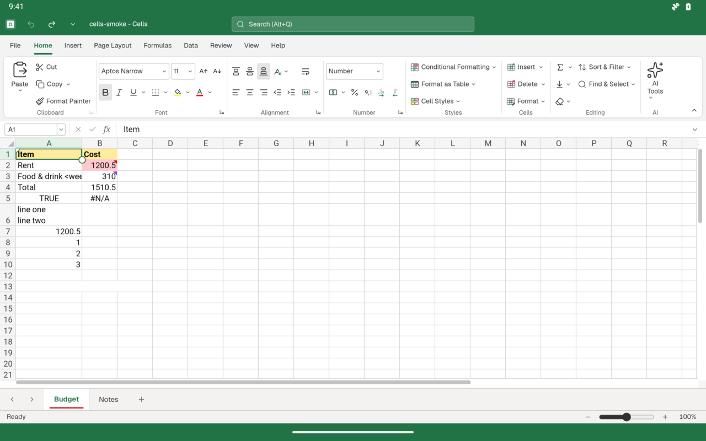

<p align="center"></p>

# Cells

A local-only spreadsheet with Excel's interface, keyboard and formula behaviour. It never talks to a cloud service.
It runs on Linux, Windows and macOS, and on Android tablets (with the full ribbon) and phones (with a layout of their
own), all on the same engine.

| Light                                               | Dark                                              |
| --------------------------------------------------- | ------------------------------------------------- |
|  |  |

| Android phone                                                     | Commands on a phone                                                      | Phone, dark                                                          |
| ----------------------------------------------------------------- | ------------------------------------------------------------------------ | -------------------------------------------------------------------- |
|  |  |  |



_Screenshots show made-up demo data. The Android ones come from emulators._

## Status

Version 0.6.0, Phase 6 of 6 (see [PLAN.md](PLAN.md) and [docs/changes.md](docs/changes.md)): installers for every
platform from one release tag ([docs/release.md](docs/release.md)), the macOS menu bar, Android tablets and phones.

## Development

```sh
npm install
npm run dev            # the app in a browser at http://localhost:1430 (try ?demo=100k)
npm run tauri dev      # the desktop app
npm test               # Vitest: core and app
npm run bench          # core benchmarks on a 100,000 × 20 sheet
npm run lint           # ESLint, Prettier and the package-boundary check
npm run typecheck
npm run tauri build    # .deb and AppImage
npm run tauri android build -- --debug --target x86_64 --apk   # an Android build for the emulator
scripts/android-smoke.sh emulator-5554 phone                    # open, edit, save, scroll and Back on an emulator
```

Linux needs WebKitGTK 4.1 and GTK 3 development packages for the desktop build.

## Layout

| Path                | What                                                                                      |
| ------------------- | ----------------------------------------------------------------------------------------- |
| `packages/core`     | The workbook model, operations, undo, navigation, fill, formatting. Pure TypeScript only. |
| `packages/platform` | Interfaces the shells implement (clipboard, window).                                      |
| `app/`              | The React shell: canvas grid, formula bar, status bar, dialogs.                           |
| `src-tauri/`        | The Tauri 2 desktop shell.                                                                |
| `design/`           | The app icon's master SVG.                                                                |
| `docs/`             | `changes.md`, `next-todo.md`, `verify-list.md`.                                           |

## License

MIT
